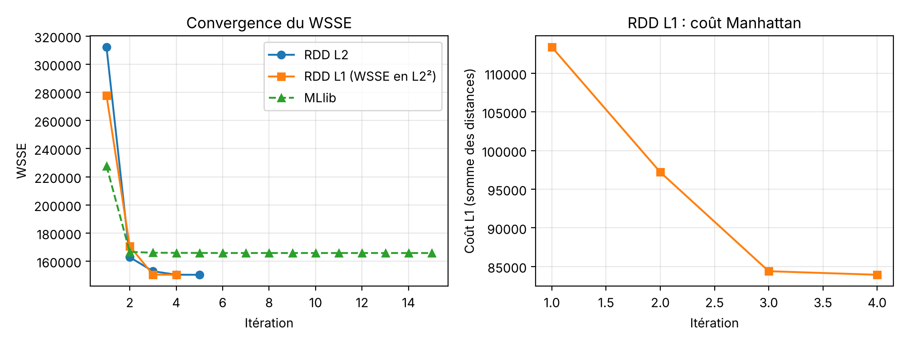
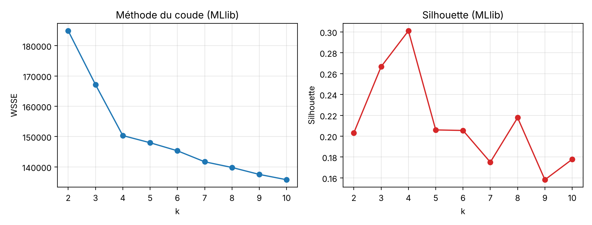
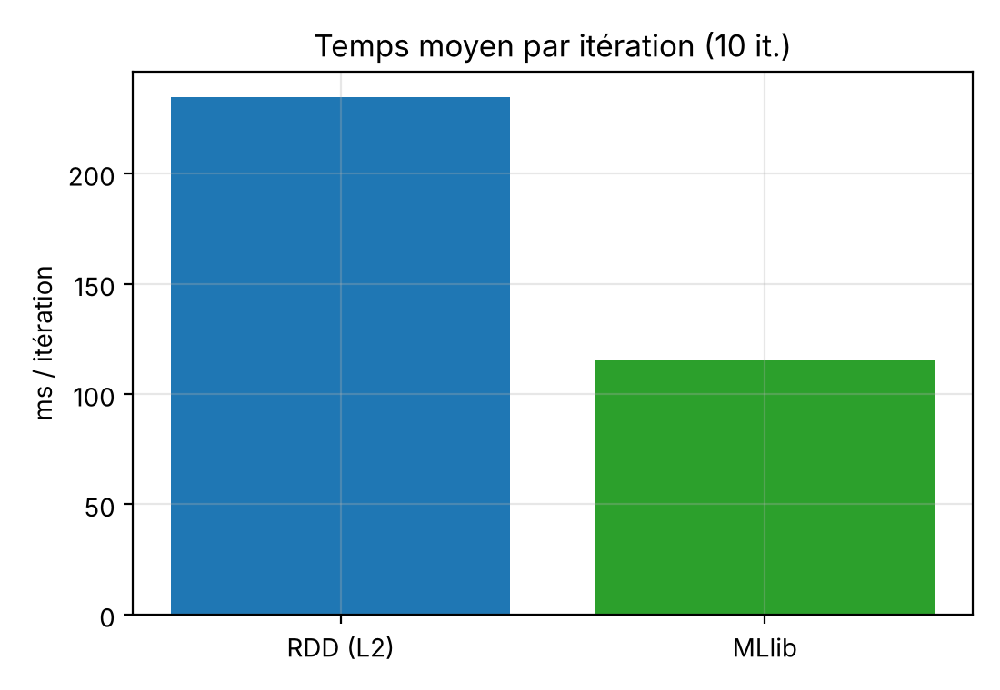
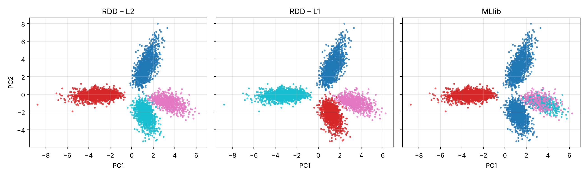

# Clustering de documents — K-Means RDD vs MLlib

Mini-projet réalisé dans le cadre du module Big Data avec PySpark.

## Objectif

Implémenter K-Means avec les primitives RDD de Spark, puis comparer
cette implémentation à celle de PySpark MLlib.

L'étude porte sur :
- les distances euclidienne (L2) et Manhattan (L1) ;
- la convergence du coût WSSE ;
- les temps d'exécution ;
- la qualité des groupes ;
- le choix du nombre de clusters.

## Technologies

Python, PySpark, NumPy, Matplotlib et scikit-learn.

## Organisation

- `data_utils.py` : génération, chargement et préparation des données.
- `custom_kmeans_rdd.py` : implémentation distribuée avec les RDD.
- `benchmark_kmeans.py` : comparaison avec MLlib et génération des figures.
- `results.json` : résultats numériques.
- `figures/` : graphiques.
- `kmeans_convergence_report.pdf` : rapport détaillé.

## Installation

Java doit être installé et compatible avec la version de PySpark utilisée.

```bash
pip install -r requirements.txt
```

## Exécution

Depuis le dossier du projet :

```bash
python custom_kmeans_rdd.py --metric l2 --k 4 --max-iter 15
python custom_kmeans_rdd.py --metric l1 --k 4 --max-iter 15
python benchmark_kmeans.py --k 4 --max-iter 15 --seed 42
```

Le dossier `figures` doit exister avant le lancement du benchmark.

Pour utiliser un fichier Spambase :

```bash
python benchmark_kmeans.py --data spambase.data --k 4
```

## Données et limites

Les résultats fournis utilisent 4 601 observations synthétiques
de type Spambase et une exécution Spark en mode local.

L'implémentation actuelle utilise les 58 colonnes, y compris
l'étiquette. Une étude strictement non supervisée doit exclure
cette dernière des variables utilisées pour le clustering.

La variante L1 utilise Manhattan pour l'affectation, mais conserve
la moyenne pour actualiser les centres : ce n'est pas un K-Medians exact.

Le chargement et le prétraitement des données sont réalisés
localement avec NumPy avant leur distribution dans Spark.

## Visualisations






## Auteurs

À compléter avec les noms des membres du projet.